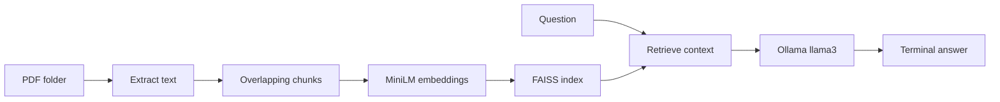

# PDF-Rag

**Ask questions over local PDF collections with semantic retrieval and Ollama.**

PDF-Rag extracts PDF text, splits it into overlapping chunks, embeds them with `sentence-transformers/all-MiniLM-L6-v2`, and retrieves context from FAISS before generating an answer with a local `llama3` model.

This is a terminal prototype. It does not provide OCR, evaluated answer accuracy, a service API, or production deployment guarantees.

## Quick start

Use **Python 3.11 or 3.12** and an installed, running [Ollama](https://ollama.com/download) service. Run all commands from the repository root.

```sh
git clone https://github.com/IAbuElRuzz/PDF-Rag.git
cd PDF-Rag
python3 -m venv .venv
source .venv/bin/activate
python -m pip install --upgrade pip
python -m pip install -r requirements.txt
python -m pip check
ollama pull llama3
python run.py
```

On Windows, create the environment with `py -3.12 -m venv .venv` and activate it with `.venv\Scripts\Activate.ps1` in PowerShell. If Ollama is not running, start its application or run `ollama serve` in a separate terminal.

Place text-based PDFs in `pdf_folder/` before starting. The repository includes a sample PDF. Type a question at the terminal prompt; use `exit` or `quit` to stop.

The initial setup requires network access to install packages and download Ollama and embedding models. Once downloaded, inference uses the local Ollama service; model installation is not an offline operation.

### Choose an extraction pipeline

| Entry point | Extraction | Additional behavior |
| --- | --- | --- |
| `python run.py` | PyPDF2 | Terminal question answering |
| `python run_pdf_plumber.py` | pdfplumber | Displays two semantic-search matches before answering |

The second script's displayed matches come from a separate search; they are not guaranteed to be exactly the documents selected by RetrievalQA. Neither script currently prints page-level answer citations.

## Retrieval architecture



Both scripts use 1,000-character chunks with 200-character overlap, Hugging Face embeddings, FAISS persistence, and LangChain RetrievalQA. The LangChain dependencies are constrained to the 0.3 family to retain the legacy imports used by this prototype; migration to current APIs is separate work. The embedding dependencies also retain a compatible Transformers 4.x and NumPy 1.x stack for older CPU wheels. These are compatibility ranges, not a fully locked dependency graph; this legacy stack still needs ongoing dependency and security maintenance.

## Cache behavior and troubleshooting

The scripts write `documents.pkl` and `faiss_index/` in the working directory. They do not automatically detect changed PDFs or embedding settings. After changing inputs, stop the program and remove **only these generated caches** before rerunning:

```sh
python -c "from pathlib import Path; import shutil; Path('documents.pkl').unlink(missing_ok=True); shutil.rmtree('faiss_index', ignore_errors=True)"
```

Only use cache files you generated and trust. Python pickle can execute code during deserialization. Never load downloaded or untrusted cache files, and do not enable FAISS's dangerous-deserialization option as a general troubleshooting workaround.

- **`ModuleNotFoundError`:** activate the virtual environment and install the complete requirements file. Both PDF parsers are included.
- **`langchain.chains` import errors:** use the declared 0.3 compatibility ranges in a fresh Python 3.11/3.12 environment; unconstrained LangChain upgrades can remove legacy APIs.
- **FAISS refuses cached deserialization:** the current loader does not opt into unsafe deserialization. Remove the generated caches and rebuild; loading saved indexes needs a deliberate trust-boundary redesign.
- **Connection refused or missing model:** confirm Ollama is running and `ollama list` includes `llama3`.
- **No extracted text:** scanned/image-only PDFs require OCR, which is not implemented.
- **Poor answers:** inspect extracted text and retrieved context. An answer is model output, not verified evidence.

The tracked FAISS binary alone is not a complete reusable cache. Building from the PDFs is the supported first-run workflow.

## Development checks

```sh
python -m pip check
python -m compileall -q run.py run_pdf_plumber.py
python -c "import sentence_transformers; import run, run_pdf_plumber; assert run.split_texts(['hello world'])"
```

The import/chunking check does not download model weights or call Ollama. An end-to-end question-answering demonstration requires local models and is not established by these checks.

## License status

The original README stated MIT, but this repository currently has no standalone LICENSE file. An explicit license file and copyright statement should be added by the owner to clarify reuse terms.
